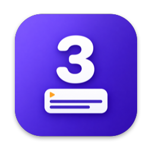
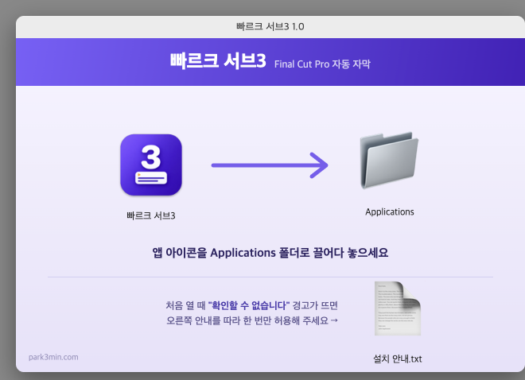

<h1 align="center">빠르크 서브3</h1>

Final Cut Pro 자동 자막 플러그인 (Workflow Extension)

말하는 영상을 넣으면 한국어 음성을 자막으로 만들고, 말 없는 구간을 잘라낸 뒤, 내 Motion 타이틀 템플릿 모양 그대로 Final Cut Pro 타임라인에 올립니다.

## 기능

- **자동 자막**: Apple 음성 인식으로 한국어를 자막으로 바꿉니다. 영상은 Mac 밖으로 나가지 않습니다.
- **무음 삭제**: 말 없는 구간을 찾아 잘라냅니다. 강의용, 브이로그용, 인터뷰용 프리셋이 있습니다.
- **템플릿 그대로**: Motion 타이틀 템플릿(.moti)을 등록하면 글꼴, 크기, 색 같은 스타일을 템플릿 그대로 씁니다.
- **키보드 편집기**: ↩ 나누기, ⌫ 합치기, ⌘←→ 시작·끝 0.1초 조정, 찾기/바꾸기, 파형 타임라인
- **다듬기**: 용어 사전, 군더더기 말(어, 음) 제거, 마침표 정리, 두 줄 자동 분배
- **그 밖에**: 가져오기 전 미리보기, 여러 영상 한 번에 처리, SRT/VTT 불러오기
- **기존 프로젝트 수정**: FCP 프로젝트의 자막을 불러와 고치고 다시 가져옵니다. 자막 줄을 고르면 FCP 재생 헤드가 그 위치로 이동합니다. SRT 로도 저장할 수 있습니다.
- **편집한 프로젝트에 자동 자막** (1.1): 컷 편집이 끝난 프로젝트의 타임라인 소리를 듣고 자막을 만들어 넣습니다. 위쪽 레인 B롤 소리는 빼고, 아래에 붙인 마이크 녹음은 넣습니다.
- **지우면 영상도 자르기** (1.1): 새 영상 모드에서 자막 줄을 지우면 그 구간이 영상에서도 빠집니다. ⌘Z 로 함께 돌아옵니다.
- **유튜브 초안** (1.1): 자막 내용으로 제목 후보 3개, 소개, 다루는 내용, 챕터를 Apple Intelligence 가 이 Mac 안에서 만듭니다. Gemini, ChatGPT 용 프롬프트 복사도 됩니다.
- **원고 불러오기** (1.2): 미리 써 둔 .txt 원고를 불러오면 한 줄이 자막 하나가 되고, 영상 소리에 맞춰 시간이 정해집니다. 시간이 적힌 .srt/.vtt/.txt 는 그 시간을 그대로 씁니다.

## 요구 사항

- Apple Silicon Mac
- macOS 26 이상
- Final Cut Pro 12 이상
- 첫 분석 때 한국어 음성 모델 다운로드 (인터넷 필요)
- 유튜브 초안은 Apple Intelligence 를 켜야 합니다

## 설치

1. [Releases](https://github.com/Park3min/sub3/releases/latest)에서 `Sub3-1.2.0.dmg` 를 받습니다.
2. DMG 를 열고 **빠르크 서브3** 를 Applications 폴더로 끌어다 놓습니다.
3. Applications 에서 빠르크 서브3 를 엽니다. (애플 개발자 인증과 공증을 받은 앱이라 보안 경고 없이 바로 열립니다)
4. 앱 창에 "Final Cut Pro 확장이 준비되었습니다" 가 보이면 설치가 끝났습니다.
   빨간 "확장 등록을 확인하지 못했습니다" 가 보이면 Final Cut Pro 를 한 번 열었다가 종료한 뒤 **다시 시도** 를 누르세요.
   (macOS 를 업데이트한 뒤 Final Cut Pro 를 아직 열지 않았으면 생깁니다)
5. Final Cut Pro 툴바 왼쪽의 확장 버튼(또는 윈도우 > 확장 프로그램)에서 **빠르크 서브3** 를 엽니다.

예전 이름(FCP AutoCut)으로 설치한 적이 있다면 그 앱을 지우고 설치해 주세요.

## 사용 순서

1. 패널의 **+** 로 자막에 쓸 Motion 타이틀 템플릿을 등록합니다.
2. 영상 파일이나 FCP 브라우저의 클립을 패널에 끌어다 놓고 **분석 시작** 을 누릅니다.
   미리 써 둔 원고가 있으면 **원고…** 로 불러오거나 영상과 함께 끌어다 놓습니다.
3. 자막을 키보드로 다듬고, 필요하면 **미리보기** 로 확인합니다.
4. **FCP로 가져오기** 를 누르면 무음이 잘린 프로젝트와 자막이 만들어집니다.

이미 편집한 프로젝트에 자막을 넣으려면 위쪽에서 **기존 프로젝트 자막 수정** 을 고르고, FCP 브라우저의 프로젝트를 패널에 끌어다 놓은 뒤 **음성으로 자막 만들기** 를 누릅니다.

## 만든 사람

빠르크 · [park3min.com](https://park3min.com)

## 문의

사용하다 문제가 생기면 [Issues](https://github.com/Park3min/sub3/issues)에 남겨 주세요.
